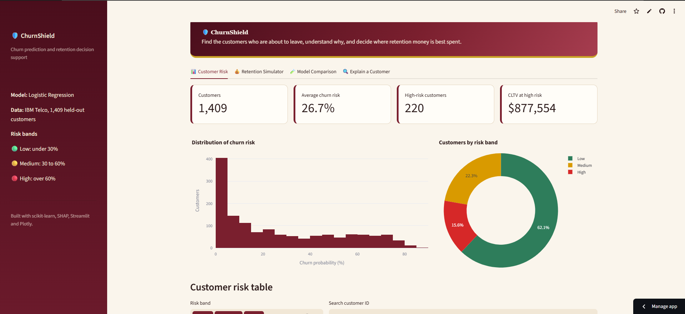
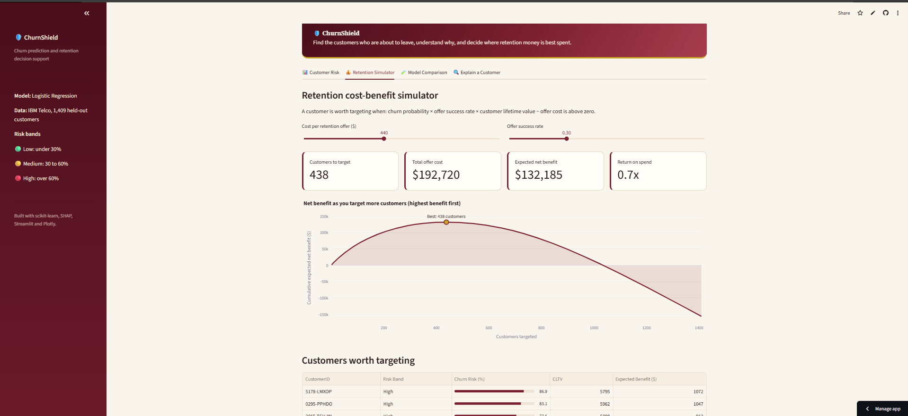
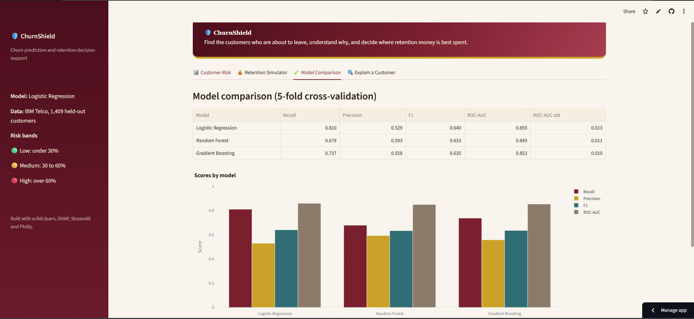
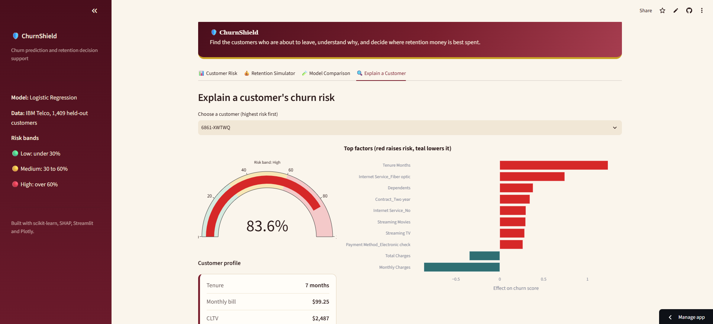

# 🛡️ ChurnShield

**Customer Churn Prediction & Decision Intelligence**

ChurnShield is a machine learning decision-support system that identifies customers
likely to leave, explains the factors driving churn, and helps prioritise retention
spending using a cost-benefit simulator.

🔗 **Live app:** https://churnshield-52npunfyym8dehsdwlvncj.streamlit.app/

## Screenshots

| Customer Risk | Retention Simulator |
|---|---|
|  |  |

| Model Comparison | Explain a Customer |
|---|---|
|  |  |


## Features

- **Customer Risk:** churn probability for every customer, risk bands (low, medium, high),
  filters, search and CSV export.
- **Retention Simulator:** set the offer cost and success rate with sliders and see which
  customers are worth targeting, the total cost, and the expected net benefit.
- **Model Comparison:** Logistic Regression, Random Forest and Gradient Boosting compared
  with 5-fold cross-validation.
- **Explain a Customer:** a risk gauge and the top factors raising or lowering the risk
  for any selected customer.

## Results

Models were compared with 5-fold cross-validation on the training data
(class 1 = customers who churned):

| Model | Recall | Precision | F1 | ROC-AUC |
|---|---|---|---|---|
| **Logistic Regression** | **0.810** | 0.529 | **0.640** | **0.859** |
| Random Forest | 0.678 | 0.593 | 0.633 | 0.849 |
| Gradient Boosting | 0.737 | 0.558 | 0.635 | 0.853 |

Logistic Regression was chosen as the final model: it has the best recall, F1 and
ROC-AUC, and its coefficients are easy to explain. Probabilities were calibrated
(sigmoid, 5-fold) so that predicted risk matches the real churn rate.

## Method

1. **Data:** IBM Telco Customer Churn dataset (7,043 customers).
2. **Cleaning:** fixed blank `Total Charges` values (new customers with zero tenure),
   removed leakage columns (`Churn Score`, `Churn Reason`, `Churn Label`) and constant or
   ID columns, encoded categorical features.
3. **Class imbalance:** about 26.5% of customers churn, handled with
   `class_weight="balanced"` and judged by recall, precision, F1 and ROC-AUC rather than
   accuracy.
4. **Explainability:** SHAP analysis in the notebook; the app shows per-customer factor
   contributions from the model weights.
5. **Decision layer:** expected benefit = churn probability × offer success rate ×
   customer lifetime value (CLTV) − offer cost. A customer is targeted when this is
   positive.

## Tech stack

Python, Pandas, scikit-learn, SHAP, Streamlit, Plotly.

## Run locally

```bash
git clone https://github.com/Isha-0912/ChurnShield.git
cd ChurnShield
python -m venv venv
venv\Scripts\activate          # Windows (use: source venv/bin/activate on Mac/Linux)
pip install -r requirements.txt
streamlit run app/streamlit_app.py
```

## Project structure

```text

ChurnShield/
├── app/
│   └── streamlit_app.py       # Streamlit dashboard
├── data/
│   ├── Telco_customer_churn.xlsx
│   ├── risk_table.csv         # customer risk scores
│   └── test_features.csv      # features used for explanations
├── models/
│   ├── churn_model.joblib     # final model (Logistic Regression)
│   ├── churn_model_calibrated.joblib
│   ├── feature_columns.joblib
│   └── model_comparison.csv   # cross-validation results
├── notebooks/
│   └── 01_eda.ipynb           # cleaning, modelling, SHAP, simulator
├── docs/                      # README screenshots
├── .streamlit/
│   └── config.toml            # app theme
├── requirements.txt
└── README.md
```


## Limitations

- The dashboard covers the 1,409 held-out test customers, not the full dataset.
- Simulator results depend on assumptions (offer cost, success rate, CLTV) and are
  meant for comparing strategies, not as forecasts.
- Several features overlap (tenure, monthly charges, total charges, internet service),
  so individual coefficients should be read with care.